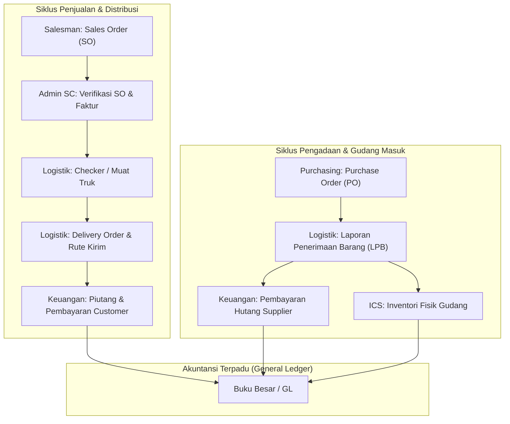

# Dokumentasi Modul Sistem — KARISMA ERP

Dokumen ini menyajikan analisis dan daftar lengkap seluruh modul aplikasi **KARISMA ERP** yang terintegrasi pada portal dashboard utama (`https://karismaerp.test/dashboard`), dikelompokkan berdasarkan departemen, alur bisnis, serta fungsionalitas detailnya.

---

## Daftar Isi
1. [Modul Penjualan & Distribusi (Sales)](#1-modul-penjualan--distribusi-sales)
2. [Modul Logistik & Inventori Gudang (ICS)](#2-modul-logistik--inventori-gudang-ics)
3. [Modul Pengadaan & Pembelian (Purchasing)](#3-modul-pengadaan--pembelian-purchasing)
4. [Modul Keuangan & Akuntansi (Finance & Accounting)](#4-modul-keuangan--akuntansi-finance--accounting)
5. [Modul Human Resource & Operasional (HRD)](#5-modul-human-resource--operasional-hrd)
6. [Modul Administrasi Sistem & Teknologi Informasi (IT / Admin)](#6-modul-administrasi-sistem--teknologi-informasi-it--admin)
7. [Matriks Hubungan Antar Modul Utama](#7-matriks-hubungan-antar-modul-utama)

---

## 1. Modul Penjualan & Distribusi (Sales)

Modul Sales menangani seluruh siklus penjualan mulai dari input pesanan salesman di lapangan, verifikasi pesanan, penerbitan faktur, manajemen rute pengiriman, hingga penanganan retur dan plafon pelanggan.

### 1.1. Sales Order (SO)
- **Rute URL**: [`sales_order`](file:///c:/laragon/www/karismaerp/application/controllers/sales/C_SalesOrder.php)
- **Deskripsi & Fitur Utama**:
  - **Daftar Sales Order**: Monitoring seluruh dokumen pesanan pelanggan dengan filter tanggal, rute salesmen, nama toko/customer, dan status order (*draft*, *sedang verifikasi*, *siap kirim*, *partial*, *completed*).
  - **Input / Create Sales Order**: Pembuatan order baru oleh salesman/admin dengan pemilihan produk, kuantitas, harga dasar, diskon reguler/promo, dan ketentuan pembayaran (tunai/kredit tempo).
  - **Detail & Verifikasi SO**: Pengecekan item pesanan, ketersediaan stok fisik gudang, dan sinkronisasi siap loading ke bagian gudang/checker.
  - **Cancel & Partial Cancellation**: Penanganan pembatalan pesanan penuh atau pembatalan sebagian item barang yang memerlukan verifikasi atasan (*MNGSC*).
  - **Kembalikan Sisa SO ke Sales**: Fitur otomatis untuk mengembalikan sisa kuantitas item yang belum terkirim dari order partial kembali ke antrean salesman.

### 1.2. Admin SC (Sales Counter / Verification Center)
- **Rute URL**: [`sales_order/admin_sc`](file:///c:/laragon/www/karismaerp/application/controllers/sales/C_SalesOrder.php#L904)
- **Deskripsi & Fitur Utama**:
  - **Monitoring SO Siap Proses**: Antrean pesanan masuk dari tim sales yang telah tervalidasi dan siap ditindaklanjuti menjadi dokumen faktur pengiriman.
  - **Pilih Barang & Buat Faktur**: Proses seleksi barang yang ready di gudang untuk di-generate menjadi faktur penjualan (Faktur Z atau faktur langsung).
  - **Approval Harga & Plafon Kredit**: Pengajuan approval harga khusus atau over-plafon limit piutang customer sebelum faktur dapat dicetak.
  - **Monitoring Faktur Selesai**: Daftar faktur yang telah selesai diproses beserta status cetak surat jalan dan penugasan rute kirim.
  - **Cetak Faktur Rute Pengiriman**: Cetak massal seluruh faktur sesuai rute pengiriman armada logistik.
  - **Activity Log Admin SC**: Pencatatan audit trail setiap aksi verifikasi, perubahan harga, dan penerbitan faktur.

### 1.3. Sales Order Loby
- **Rute URL**: [`sales_order_loby`](file:///c:/laragon/www/karismaerp/application/controllers/sales/C_SalesOrderLoby.php)
- **Deskripsi & Fitur Utama**:
  - Penjualan langsung (*walk-in customer*) yang datang langsung ke kantor/loby perusahaan.
  - Pembuatan faktur kontan cepat dengan pemotongan stok otomatis tanpa melalui antrean rute logistik luar kota.

### 1.4. Pecah Faktur
- **Rute URL**: [`sales_order/pecah_faktur`](file:///c:/laragon/www/karismaerp/application/controllers/sales/C_SalesOrder.php#L3200)
- **Deskripsi & Fitur Utama**:
  - Pemecahan **Faktur Z** (faktur konsolidasi gabungan) menjadi beberapa faktur turunan per masing-masing kios/toko tujuan.
  - Penyesuaian nomor faktur resmi, alokasi nilai tagihan, dan rute drop point barang.

### 1.5. Faktur Penjualan (Audit & Koreksi)
- **Rute URL**: [`admin/transaksi`](file:///c:/laragon/www/karismaerp/application/controllers/admin/Transaksi.php)
- **Deskripsi & Fitur Utama**:
  - Manajemen dan pengawasan seluruh transaksi faktur komersial.
  - Fasilitas koreksi kuantitas/harga khusus dengan hak akses terbatas serta sinkronisasi otomatis jurnal piutang dan HPP ke akuntansi.

### 1.6. Test Market (Uji Pasar / Konsinyasi Keluar)
- **Rute URL**: [`test-market`](file:///c:/laragon/www/karismaerp/application/controllers/sales/C_TestMarket.php)
- **Deskripsi & Fitur Utama**:
  - Pengelolaan produk baru atau promosi yang dititipkan di kios pelanggan untuk masa percobaan.
  - Monitoring barang titipan awal, realisasi unit yang laku terjual (dikonversi menjadi faktur reguler), dan sisa stok fisik yang masih dititipkan di kios.

### 1.7. Katalog Sales
- **Rute URL**: [`kiu_katalog`](file:///c:/laragon/www/karismaerp/application/controllers/Katalog.php)
- **Deskripsi & Fitur Utama**:
  - Katalog digital produk visual untuk kebutuhan presentasi sales di hadapan calon pembeli.
  - Informasi harga resmi, deskripsi teknis produk, foto kemasan, dan ketersediaan stok aktual.

### 1.8. Sales Report & Stok Online
- **Rute URL**: [`sales_report`](file:///c:/laragon/www/karismaerp/application/controllers/Sales_report.php) & [`stock`](file:///c:/laragon/www/karismaerp/application/controllers/Stock.php)
- **Deskripsi & Fitur Utama**:
  - **Sales Report**: Rekapitulasi omset harian, performa target penjualan salesmen, dan riwayat volume transaksi per wilayah.
  - **Stok Online**: Monitoring stok barang yang dialokasikan khusus untuk kanal penjualan daring/e-commerce.

### 1.9. Data Customers (Master Pelanggan)
- **Rute URL**: [`data_customers`](file:///c:/laragon/www/karismaerp/application/controllers/C_DataCustomer.php)
- **Deskripsi & Fitur Utama**:
  - Master data toko/kios pelanggan (nama usaha, nama pemilik, NIK/NPWP, nomor telepon, alamat, rute kirim, dan koordinat maps).
  - Pengaturan plafon kredit (limit piutang) dan jangka waktu tempo pembayaran (*top terms*).

### 1.10. Retur Penjualan
- **Rute URL**: [`retur_penjualan`](file:///c:/laragon/www/karismaerp/application/controllers/Retur_penjualan.php)
- **Deskripsi & Fitur Utama**:
  - Penerimaan klaim pengembalian produk dari kios (karena barang rusak, kedaluwarsa, atau tidak laku).
  - Validasi fisik barang oleh QC/Logistik dan penerbitan nota retur penjualan untuk memotong saldo piutang pelanggan.

### 1.11. Pengajuan Overdue (OD)
- **Rute URL**: [`sales/C_PengajuanOD`](file:///c:/laragon/www/karismaerp/application/controllers/sales/C_PengajuanOD.php)
- **Deskripsi & Fitur Utama**:
  - Pengajuan perpanjangan tempo faktur yang telah melewati jatuh tempo (*overdue*).
  - Alur persetujuan (*approval flow*) berjenjang oleh Manajer Sales hingga Direktur Keuangan sebelum customer dapat melakukan pemesanan ulang.

---

## 2. Modul Logistik & Inventori Gudang (ICS)

**ICS (Inventory Control System)** merupakan modul inti operasional gudang KARISMA ERP yang mengontrol pergerakan fisik barang masuk, mutasi internal, penyimpanan berbasis lot/expired date, hingga pemuatan barang ke armada pengiriman.

### 2.1. Activity Warehouse / Checker
- **Rute URL**: [`checker`](file:///c:/laragon/www/karismaerp/application/controllers/checker/C_Checker.php)
- **Deskripsi & Fitur Utama**:
  - **Pemeriksaan Loading Barang**: Verifikasi fisik saat barang dinaikkan ke armada truk pengiriman berdasarkan faktur siap kirim.
  - **Manajemen Trip & Armada**: Pencatatan nomor lambung kendaraan, supir, kenek, dan urutan trip (Trip 1, Trip 2, dst).
  - **Format Kuantitas Ganda**: Pengecekan akurat dalam satuan box/dus besar dan pcs/kemasan eceran.
  - **Muatan Tambahan**: Pencatatan barang tambahan mendesak yang dititipkan pada armada berjalan.

### 2.2. Master Data Barang & Inventori Terpadu
- **Rute URL**:
  - Data All Barang: [`ics/by_allbarang`](file:///c:/laragon/www/karismaerp/application/controllers/ics/Ics.php)
  - Data By Expired Date: [`ics/by_expdate`](file:///c:/laragon/www/karismaerp/application/controllers/ics/Ics.php)
  - Barang Per Gudang: [`ics/barangpergudang`](file:///c:/laragon/www/karismaerp/application/controllers/ics/Ics.php)
  - Export Data Expired: [`export-stock`](file:///c:/laragon/www/karismaerp/application/controllers/ExportStock.php)
- **Deskripsi & Fitur Utama**:
  - **Monitoring Multi-Gudang**: Pemantauan kuantitas stok terpusat di semua cabang gudang fisik (Gudang Utama, Gudang Transit, Gudang Retur, dll).
  - **Kontrol Lot & Kedaluwarsa (FEFO)**: Pengawasan masa aktif produk dengan sistem peringatan dini (warning expired 30/60/90 hari).
  - **Master PIC Barang**: Pembagian tanggung jawab pemeliharaan kelompok barang tertentu kepada staf gudang spesifik (*PIC*).

### 2.3. Delivery Order (DO) & Pengiriman
- **Rute URL**:
  - Data DO: [`ics/icsdo`](file:///c:/laragon/www/karismaerp/application/controllers/ics/Ics.php)
  - Status Faktur Distribusi: [`logistik/distibusi/list_faktur_status`](file:///c:/laragon/www/karismaerp/application/controllers/logistik/C_Distribusi.php)
- **Deskripsi & Fitur Utama**:
  - Penerbitan surat jalan Delivery Order resmi untuk pengawalan armada barang ke rute tujuan.
  - Pelacakan status faktur distribusi: apakah barang masih dalam perjalanan (*on delivery*) atau sudah diterima oleh pemilik toko (*delivered*).

### 2.4. LPB (Laporan Penerimaan Barang)
- **Rute URL**:
  - Data LPB: [`ics/data_lpb`](file:///c:/laragon/www/karismaerp/application/controllers/ics/Ics.php)
  - Input LPB Manual: [`ics/lpb_manual`](file:///c:/laragon/www/karismaerp/application/controllers/ics/Ics.php)
  - Laporan LPB: [`ics/lpb_report`](file:///c:/laragon/www/karismaerp/application/controllers/ics/Ics.php)
- **Deskripsi & Fitur Utama**:
  - **Penerimaan Berbasis PO**: Pencatatan fisik barang masuk dari supplier yang disinkronkan dengan dokumen Purchase Order. Status: *Belum Diterima*, *Partial*, atau *Done*.
  - **Input LPB Manual**: Penerimaan barang non-PO atau mendesak tanpa menunggu input PO oleh Purchasing, dilengkapi pencatatan nomor lot dan tanggal expired fisik.
  - **Posting Persediaan**: Penambahan stok otomatis ke gudang tujuan setelah dokumen LPB disetujui (*final approval*).

### 2.5. Mutasi Antar Gudang & Penyesuaian Stok
- **Rute URL**:
  - Mutasi Gudang: [`ics/mutasi_barang`](file:///c:/laragon/www/karismaerp/application/controllers/ics/Ics.php)
  - Penyesuaian Stok: [`persediaan/penyesuaian_barang`](file:///c:/laragon/www/karismaerp/application/controllers/persediaan/Penyesuaian_barang.php)
  - Show Different (Audit Selisih): [`ics/ics_diffrent`](file:///c:/laragon/www/karismaerp/application/controllers/ics/Ics.php)
- **Deskripsi & Fitur Utama**:
  - Transfer internal stok antar gedung gudang dengan dokumen serah terima dan approval dua arah (gudang pengirim & penerima).
  - Koreksi stok fisik vs sistem dengan berita acara selisih.
  - Perbandingan otomatis data stok fisik ICS dengan buku besar akuntansi.

### 2.6. Retur Pembelian (Logistik)
- **Rute URL**: [`ics/retur`](file:///c:/laragon/www/karismaerp/application/controllers/ics/Ics.php)
- **Deskripsi & Fitur Utama**:
  - Pelaksanaan fisik pengeluaran barang rusak/reject yang akan dikembalikan ke pihak pabrik/supplier.

### 2.7. Stock Opname Fisik
- **Rute URL**: [`admin/stockopname`](file:///c:/laragon/www/karismaerp/application/controllers/admin/Stockopname.php)
- **Deskripsi & Fitur Utama**:
  - Manajemen jadwal opname periodik (bulanan/tahunan).
  - Pembekuan transaksi sementara (*freeze*), cetak lembar hitung fisik (*count sheet*), dan penyesuaian posting balance hasil opname.

### 2.8. Realisasi Perakitan Paket Bundling
- **Rute URL**: [`logistik/bundling`](file:///c:/laragon/www/karismaerp/application/controllers/logistik/C_Bundling.php)
- **Deskripsi & Fitur Utama**:
  - Eksekusi assembly/perakitan fisik paket promo (mengurangi stok beberapa komponen bahan baku dan menghasilkan stok produk paket jadi siap kirim).

---

## 3. Modul Pengadaan & Pembelian (Purchasing)

Modul Purchasing mengatur pengadaan barang dagang dan inventori dari prinsipal/supplier guna menjaga ketersediaan pasokan barang dengan harga terbaik.

### 3.1. Purchase Order (PO)
- **Rute URL**: [`ics/icspo`](file:///c:/laragon/www/karismaerp/application/controllers/ics/Ics.php) & [`pendingpo`](file:///c:/laragon/www/karismaerp/application/controllers/Pendingpo.php)
- **Deskripsi & Fitur Utama**:
  - Pembuatan order pembelian resmi ke pabrik/supplier mencakup harga beli, diskon bertingkat, PPN, dan estimasi waktu pengiriman (*lead time*).
  - **Pending PO Tracking**: Monitoring PO yang belum dipenuhi atau baru dikirim sebagian oleh supplier (*back-order*).

### 3.2. Verifikasi LPB & Harga Beli
- **Rute URL**: [`ics/data_lpb`](file:///c:/laragon/www/karismaerp/application/controllers/ics/Ics.php) & [`ics/lpb_manual`](file:///c:/laragon/www/karismaerp/application/controllers/ics/Ics.php)
- **Deskripsi & Fitur Utama**:
  - Pengecekan kesesuaian antara kuantitas LPB fisik dari logistik dengan invoice tagihan dari supplier.
  - Pengisian dan otorisasi harga beli pada LPB Manual yang sebelumnya dimasukkan logistik tanpa dokumen PO.

### 3.3. Retur Pembelian (Klaim Supplier)
- **Rute URL**: [`ics/retur/pembelian/monitoring`](file:///c:/laragon/www/karismaerp/application/controllers/ics/Ics.php)
- **Deskripsi & Fitur Utama**:
  - Administrasi klaim nota retur pembelian atas barang cacat/expired ke supplier.
  - Pengurangan tagihan hutang dagang atau penggantian barang baru (*replacement*).

### 3.4. Pengadaan Barang Konsinyasi (Titipan Supplier)
- **Rute URL**: [`purchasing/konsinyasi`](file:///c:/laragon/www/karismaerp/application/controllers/purchasing/Konsinyasi.php)
- **Deskripsi & Fitur Utama**:
  - Penerimaan barang dagang titipan dari supplier tanpa kewajiban bayar di muka.
  - Laporan rekonsiliasi berkala unit yang terjual untuk penerbitan tagihan resmi dari pemilik barang.

### 3.5. Permintaan Paket Bundling
- **Rute URL**: [`purchasing/bundling/request`](file:///c:/laragon/www/karismaerp/application/controllers/purchasing/C_BundlingRequest.php)
- **Deskripsi & Fitur Utama**:
  - Perancangan paket bundling promosi (komposisi barang, biaya pengemasan, dan jumlah paket yang diminta ke bagian gudang).

---

## 4. Modul Keuangan & Akuntansi (Finance & Accounting)

Modul Keuangan mencatat arus kas masuk/keluar, piutang pelanggan, hutang supplier, rekonsiliasi bank, dan penjurnalan otomatis transaksi bisnis ke buku besar hingga laporan keuangan akhir.

### 4.1. Kas Bon Karyawan
- **Rute URL**: [`C_Kasbon`](file:///c:/laragon/www/karismaerp/application/controllers/C_Kasbon.php)
- **Deskripsi & Fitur Utama**:
  - Pengajuan permohonan dana kas bon operasional oleh staf/sales/supir.
  - Persetujuan atasan bertingkat dan verifikasi realisasi nota pertanggungjawaban (*settlement* kas bon).

### 4.2. Kas Masuk, Kas Keluar & Operasional Kasir
- **Rute URL**:
  - Kas Masuk: [`keuangan/kas_masuk`](file:///c:/laragon/www/karismaerp/application/controllers/keuangan/Kas_masuk.php)
  - Kas Keluar: [`keuangan/kas_keluar`](file:///c:/laragon/www/karismaerp/application/controllers/keuangan/Kas_keluar.php)
  - Kasir Harian: [`keuangan/kasir`](file:///c:/laragon/www/karismaerp/application/controllers/keuangan/Kasir.php)
- **Deskripsi & Fitur Utama**:
  - Pencatatan transaksi harian kas kecil (*petty cash*) dan rekening bank perusahaan.
  - Penyetoran tunai hasil tagihan faktur salesman dan tutup buku kasir harian.

### 4.3. Manajemen Piutang Usaha (AR) & Pembayaran Faktur
- **Rute URL**: [`keuangan/pembayaran`](file:///c:/laragon/www/karismaerp/application/controllers/keuangan/Pembayaran.php)
- **Deskripsi & Fitur Utama**:
  - Monitoring kartu piutang per pelanggan dan analisis umur piutang (*Aging Schedule*).
  - Input pelunasan faktur penjualan (tunai, transfer bank, cek/bilyet giro, atau pemotongan nota retur).

### 4.4. Manajemen Hutang Usaha (AP) & Pembayaran Supplier
- **Rute URL**: [`keuangan/pembayaran-supplier`](file:///c:/laragon/www/karismaerp/application/controllers/keuangan/Pembayaran_supplier.php)
- **Deskripsi & Fitur Utama**:
  - Rekapitulasi hutang dagang jatuh tempo berdasarkan LPB yang sudah divalidasi.
  - Penerbitan voucher pembayaran hutang ke supplier dengan pemotongan nota retur pembelian.

### 4.5. Jurnal Otomatis & Jurnal Umum (GL)
- **Rute URL**:
  - Jurnal Penjualan: [`keuangan/penjualan`](file:///c:/laragon/www/karismaerp/application/controllers/keuangan/Penjualan.php)
  - Jurnal Pembelian: [`keuangan/pembelian`](file:///c:/laragon/www/karismaerp/application/controllers/keuangan/Pembelian.php)
  - Transaksi Jurnal Umum: [`buku_besar/jurnal_umum`](file:///c:/laragon/www/karismaerp/application/controllers/buku_besar/Jurnal_umum.php)
  - Buku Besar: [`keuangan/buku_besar`](file:///c:/laragon/www/karismaerp/application/controllers/keuangan/Buku_besar.php)
  - Master Akun (COA): [`jurnal`](file:///c:/laragon/www/karismaerp/application/controllers/Jurnal.php)
- **Deskripsi & Fitur Utama**:
  - Penjurnalan otomatis secara berpasangan (*double entry*) saat faktur terbit, LPB selesai, atau pembayaran terjadi.
  - Rekaman penyesuaian (*adjusting journal*) untuk biaya akrual, penyusutan aset tetap, dan koreksi akuntansi.
  - Buku besar per akun (*General Ledger*) dan neraca saldo (*Trial Balance*).

### 4.6. Laporan Keuangan Terpadu
- **Rute URL**: [`laporan`](file:///c:/laragon/www/karismaerp/application/controllers/Laporan.php)
- **Deskripsi & Fitur Utama**:
  - Penyusunan Laporan Laba Rugi (*Income Statement*), Neraca (*Balance Sheet*), Laporan Arus Kas, dan Laporan Nilai Persediaan Akhir.

---

## 5. Modul Human Resource & Operasional (HRD)

Menangani administrasi staf, penilaian budaya/disiplin lingkungan kerja, serta koordinasi agenda direksi.

### 5.1. Penilaian Lingkungan Kerja & Admin Penilaian
- **Rute URL**: [`penilaian_lingkungan`](file:///c:/laragon/www/karismaerp/application/controllers/penilaian_lingkungan/Penilaian.php) & [`hrd/penilaian_lingkungan/admin`](file:///c:/laragon/www/karismaerp/application/controllers/hrd/Penilaian_admin.php)
- **Deskripsi & Fitur Utama**:
  - Evaluasi berkala kerapian, kepatuhan 5S, dan kebersihan area kerja per divisi.
  - Perhitungan skor rating dan laporan kepatuhan lingkungan kerja bagi direksi.

### 5.2. Schedule Direktur
- **Rute URL**: [`schedule_direktur`](file:///c:/laragon/www/karismaerp/application/controllers/Schedule_direktur.php)
- **Deskripsi & Fitur Utama**:
  - Pengelolaan jadwal pertemuan, agenda rapat bisnis, dan jadwal dinas direktur.

---

## 6. Modul Administrasi Sistem & Teknologi Informasi (IT / Admin)

Menjamin keamanan data, integritas hak akses, pemeliharaan basis data, dan konsistensi alur sistem secara menyeluruh.

### 6.1. Manajemen Pengguna & Otorisasi Akses
- **Rute URL**:
  - User Management: [`master/user-management`](file:///c:/laragon/www/karismaerp/application/controllers/master/User_management.php)
  - Fasilitas Per User: [`master/user-facility`](file:///c:/laragon/www/karismaerp/application/controllers/master/User_facility.php)
  - Master Jobdesk: [`master/jobdesk`](file:///c:/laragon/www/karismaerp/application/controllers/master/Jobdesk.php)
  - Master Akses Level: [`master/akses-level`](file:///c:/laragon/www/karismaerp/application/controllers/master/Akses_level.php)
  - Menu Dinamis: [`master/menu`](file:///c:/laragon/www/karismaerp/application/controllers/master/Menu.php)
- **Deskripsi & Fitur Utama**:
  - Pembuatan dan pemeliharaan akun pengguna, reset sandi, dan status aktif/nonaktif.
  - Pemberian izin granular (baca, tambah, edit, hapus, cetak, unpost) per modul, per cabang, dan per gudang.
  - Pengaturan menu hierarkis aplikasi.

### 6.2. Audit Trail & Audit Logistik
- **Rute URL**:
  - Semua Transaksi: [`admin/transaksi`](file:///c:/laragon/www/karismaerp/application/controllers/admin/Transaksi.php)
  - Log LPB Manual: [`ics/lpb_manual_log`](file:///c:/laragon/www/karismaerp/application/controllers/ics/Ics.php)
- **Deskripsi & Fitur Utama**:
  - Perekaman jejak digital setiap aksi kritis (siapa, kapan, data apa yang diubah).
  - Mekanisme unpost/koreksi transaksi dengan pengawasan otorisasi admin.

---

## 7. Matriks Hubungan Antar Modul Utama

---
*Dokumentasi ini disusun sebagai acuan teknis dan operasional pengembangan sistem KARISMA ERP.*

