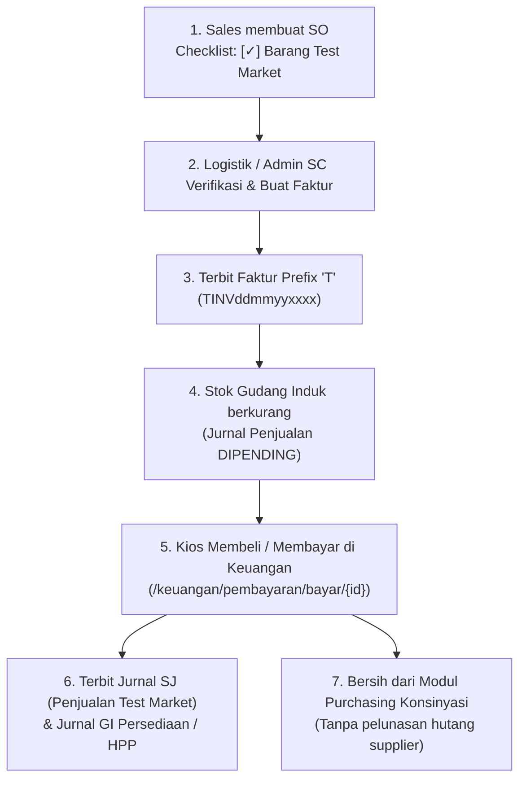

# Fitur Barang Test Market (Faktur T) — KARISMA ERP

## 1. Latar Belakang & Konsep Bisnis
Barang **Test Market** adalah barang dagangan milik Karisma sendiri (pembelian sudah diakui dan fisik barang bersumber dari **Gudang Induk**, bukan gudang titipan konsinyasi supplier) yang dititipkan ke kios untuk keperluan uji pasar (*market test*).

### Karakteristik & Perbedaan Utama:
| Parameter | Faktur Reguler (INV) | Faktur Konsinyasi (KINV) | Faktur Test Market (TINV) |
| :--- | :--- | :--- | :--- |
| **Sumber Fisik Barang** | Gudang Induk / Umum | Gudang Titipan Kios (15) | **Gudang Induk / Umum** |
| **Kepemilikan Barang** | Milik Karisma | Milik Supplier Konsinyasi | **Milik Karisma** |
| **Pengakuan Jurnal Penjualan** | Saat Faktur Terbit | Saat Pembayaran di Keuangan | **Saat Pembayaran di Keuangan** |
| **Pengakuan Jurnal HPP & Persediaan** | Saat Faktur Terbit | Saat Pembayaran di Keuangan (FIFO LPB Supplier) | **Saat Pembayaran di Keuangan (Harga Pokok Persediaan Karisma)** |
| **Pelunasan ke Supplier Konsinyasi** | Tidak Ada | Ada (Masuk ke antrean settlement Purchasing Konsinyasi) | **TIDAK ADA (Tidak masuk antrean settlement purchasing konsinyasi)** |
| **Awalan Nomor Faktur** | `[UserPrefix]INV...` | `KINVddmmyyxxxx` | **`TINVddmmyyxxxx`** |

---

## 2. Skema & Perubahan Database
Telah ditambahkan kolom flag `is_test_market` pada dua tabel utama:

1. **`tbso_sales_order`**:
   - Kolom: `is_test_market TINYINT(1) NOT NULL DEFAULT 0` (setelah `catatan`).
   - Berisi status penanda apakah Sales Order tersebut merupakan pesanan barang test market.

2. **`tbso_faktur_penjualan`**:
   - Kolom: `is_test_market TINYINT(1) NOT NULL DEFAULT 0` (setelah `cara_pembayaran`).
   - Berisi status penanda faktur test market sehingga saat pembayaran di Keuangan dikenali secara tepat.

---

## 3. Alur Operasional (Step-by-Step)

### Langkah 1: Input Sales Order
- Buka menu **Sales Order $\rightarrow$ Buat Sales Order Baru**.
- Pilih Gudang Induk (non-konsinyasi) dan Customer.
- Beri tanda centang pada checkbox:
  `[✓] Barang Test Market (Faktur T)`
  *(Stok fisik bersumber dari Gudang Induk. Penjualan & HPP diakui saat dibeli/dibayar kios via Faktur T).*
- Simpan SO. Nomor SO akan memiliki badge penanda `Test Market`.

### Langkah 2: Pembuatan Faktur (Admin SC)
- Masuk ke menu **Admin SC $\rightarrow$ SO Siap Faktur** (atau Pilih Barang Faktur).
- Saat membuka form faktur, sistem mendeteksi `is_test_market = 1` dan otomatis mengarahkan prefix nomor faktur menjadi **`T`** (`TINVddmmyyxxxx`).
- Pada form faktur terdapat notifikasi:
  *Faktur Barang Test Market (Kode Awalan T • Jurnal Penjualan diakui saat dibayar oleh kios).*
- Saat faktur disimpan:
  - Stok fisik di batch Gudang Induk berkurang.
  - Jurnal penjualan **ditunda/dipending** (tidak langsung posting ke general ledger).

### Langkah 3: Penerimaan Pembayaran (Keuangan)
- Saat kios membayar/membeli barang test market tersebut:
  Buka halaman pembayaran nota di `/keuangan/pembayaran/bayar/{id_faktur}`.
- Lakukan pembayaran sesuai nominal laku kios.
- Sistem secara otomatis menerbitkan:
  1. **Jurnal Penjualan (`SALES_INVOICE`)**:
     - *Keterangan*: `Penjualan Test Market: TINV... - [Nama Customer] (Realisasi Pembelian Kios)`
     - *Debit*: Piutang Usaha (13099)
     - *Kredit*: Penjualan Barang Dagang (41011/41010)
     - *Kredit*: PPN Keluaran (23011) jika barang kena pajak
  2. **Jurnal HPP & Persediaan (`GOODS_ISSUE`)**:
     - *Keterangan*: `Penyesuaian persediaan test market, untuk SJ...`
     - *Debit*: Harga Pokok Penjualan Test Market (51010)
     - *Kredit*: Persediaan Barang Dagang (Test Market) (14010)
  3. **Jurnal Pembayaran Kas/Bank (`RECEIPT`)**:
     - *Debit*: Kas / Bank
     - *Kredit*: Piutang Usaha
- **Modul Purchasing Konsinyasi**:
  Faktur T sama sekali **tidak disinkronkan** ke tabel `tb_konsinyasi_settlement`, sehingga halaman pelunasan hutang supplier konsinyasi tetap bersih dari transaksi test market.

---

## 4. File-File Yang Dimodifikasi
1. `application/views/content/sales/so_form.php` (penambahan checkbox Test Market).
2. `application/views/content/sales/so_list.php` (badge visual Test Market pada tabel SO).
3. `application/views/content/sales/so_detail.php` (rincian jenis SO Test Market).
4. `application/views/content/sales/faktur_form.php` (notifikasi faktur Test Market prefix T).
5. `application/controllers/sales/C_SalesOrder.php` (handling parameter `is_test_market` pada create/update SO dan generate nomor faktur prefix T).
6. `application/models/M_SalesOrder.php` (persistensi header SO & faktur, serta penundaan jurnal otomatis untuk faktur T).
7. `application/models/M_Journal.php` (realisasi jurnal penjualan, pengakuan HPP dari harga pokok barang dagang induk, dan pemisahan settlement konsinyasi).
