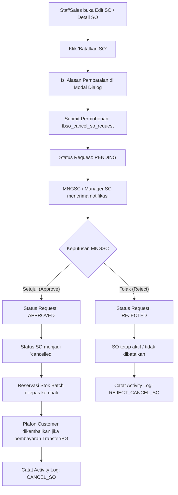

# Dokumentasi Fitur: Pembatalan Sales Order (Cancel SO) dengan Approval MNGSC (Manager SC)

## 1. Ringkasan Fitur
Fitur ini mengatur mekanisme pembatalan dokumen **Sales Order (SO)** di sistem Karisma ERP agar setiap permohonan pembatalan dari sales/staf tidak langsung membatalkan transaksi secara sepihak, melainkan wajib melalui persetujuan (*approval*) dari **MNGSC (Manager SC)** atau Administrator.

---

## 2. Hak Akses & Peran Pengguna
* **Pemohon Pembatalan (Staf / Sales / Admin SC)**:
  * Dapat mengajukan permohonan pembatalan SO dengan mencantumkan alasan pembatalan.
  * Status SO yang diajukan akan masuk antrean persetujuan (*pending*).
* **Atasan / Penyetuju (MNGSC - Manager SC / Administrator)**:
  * Memiliki wewenang untuk **Menyetujui (Approve)** atau **Menolak (Reject)** permohonan pembatalan.
  * Dapat menyetujui langsung saat berada di halaman form edit SO maupun detail SO.

---

## 3. Struktur Tabel Database (`tbso_cancel_so_request`)

Tabel `tbso_cancel_so_request` dibuat secara otomatis jika belum tersedia melalui method `ensure_cancel_so_request_table()`:

```sql
CREATE TABLE IF NOT EXISTS `tbso_cancel_so_request` (
    `id` INT AUTO_INCREMENT PRIMARY KEY,
    `id_so` INT NOT NULL,
    `no_so` VARCHAR(30) NOT NULL,
    `alasan` TEXT NULL,
    `status` ENUM('pending','approved','rejected') NOT NULL DEFAULT 'pending',
    `request_by` VARCHAR(50) NOT NULL,
    `request_at` DATETIME NOT NULL DEFAULT CURRENT_TIMESTAMP,
    `approve_by` VARCHAR(50) NULL,
    `approve_at` DATETIME NULL,
    `catatan_approval` TEXT NULL,
    KEY `idx_id_so` (`id_so`),
    KEY `idx_status` (`status`)
) ENGINE=InnoDB DEFAULT CHARSET=utf8mb4;
```

---

## 4. Alur Kerja (Workflow)



---

## 5. Dampak Pembatalan terhadap Stok & Plafon Customer

1. **Alokasi Stok (Reserved Stock)**:
   * Saat disetujui (*Approve*), sistem secara otomatis memanggil `_kurangi_reserved_batch()` untuk melepas reservasi stok batch barang di gudang.
2. **Plafon Customer**:
   * **Pembayaran Cash**: Tidak memotong plafon saat pembuatan SO, sehingga saat dibatalkan **tidak menambah/me-restore plafon**.
   * **Pembayaran Transfer / BG**: Memotong plafon saat pembuatan SO, sehingga saat disetujui batal oleh MNGSC, plafon customer di `tb_customer` **dikembalikan secara utuh**.

---

## 6. Endpoint & Routing

* `POST sales_order/request_cancel_so` -> Mengajukan permohonan pembatalan SO.
* `POST sales_order/approve_cancel_so` -> Approval pembatalan SO oleh MNGSC/Admin.
* `POST sales_order/reject_cancel_so` -> Penolakan pembatalan SO oleh MNGSC/Admin.

